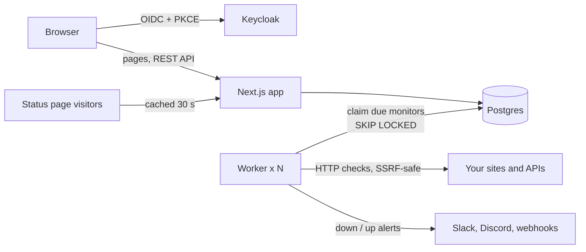

# Pulseboard

**Self-hosted uptime monitoring and public status pages.** Pulseboard checks your sites and APIs on a
schedule, opens an incident and alerts Slack, Discord or a signed webhook when something breaks, and
keeps a status page your customers can read. Sign-in goes through Keycloak.

[](https://github.com/qaweem321/pulseboard/actions/workflows/ci.yml)


## Features

- **HTTP checks** every 30 seconds to an hour: accepted status ranges (`200-299,301`), keyword
  matching, timeouts, redirects, and a failure threshold so one blip doesn't page anyone.
- **Incidents** open when a monitor goes down and close when it recovers. Editors post updates
  (investigating, identified, monitoring, resolved) that appear on status pages.
- **Alerts** to Slack, Discord or any webhook. Webhooks are signed with a timestamped HMAC, like Stripe's.
- **Public status pages** with 90-day uptime bars, rendered on the server and cached for 30 seconds.
  They never expose monitor URLs or error messages.
- **D3 charts**: response time with failure markers (24 hours, 7 days, 30 days), daily uptime bars and sparklines.
- **Single sign-on** with Keycloak (OpenID Connect, PKCE). Realm roles map to viewer, editor and admin.
- **SSRF protection**: monitors and webhooks can't reach your private network unless you allowlist a host.
- **Scales out**: run as many workers as you like; Postgres `FOR UPDATE SKIP LOCKED` hands each
  monitor to exactly one of them.

## Quick start

You need Docker.

```bash
git clone https://github.com/qaweem321/pulseboard.git
cd pulseboard
docker compose --profile app up -d --build
```

Open http://localhost:3400 and sign in with one of the demo accounts:

| Username   | Password   | Role                                      |
| ---------- | ---------- | ----------------------------------------- |
| `admin`    | `admin`    | Everything, including alert channels      |
| `editor`   | `editor`   | Monitors, incidents and status pages      |
| `viewer`   | `viewer`   | Read-only                                 |
| `newcomer` | `newcomer` | No role: sees the "ask for access" screen |

The demo seed adds five monitors with 90 days of **synthetic** history, so the charts have data on
day one, plus a public status page at http://localhost:3400/status/demo. New checks are real.
Keycloak's admin console is at http://localhost:8080 (`admin` / `admin`).

These passwords and secrets are for local use only. Change them before deploying.

## Development

```bash
docker compose up -d          # Postgres and Keycloak only
cp .env.example .env.local
npm ci
npm run db:migrate && npm run db:seed
npm run dev                   # http://localhost:3400
npm run worker                # in a second terminal: runs the checks
```

| Command                                  | What it does                                                |
| ---------------------------------------- | ----------------------------------------------------------- |
| `npm test`                               | Jest: unit, component (React Testing Library) and SQL tests |
| `npm run check`                          | Lint, format check, typecheck and tests, like CI            |
| `npm run db:generate -- --name <change>` | New migration after editing `src/server/db/schema.ts`       |

Commits follow [Conventional Commits](https://www.conventionalcommits.org/). A commit-msg hook
(commitlint) rejects other formats, and lint-staged formats staged files.

## How it works



- **Worker loop** (`worker/index.ts`, every 2 seconds): claim due monitors and schedule their next
  check in one statement, run checks in parallel (10 at a time), store each result and apply the
  state change in one transaction, then send alerts.
- **State machine** (`src/server/monitoring/transition.ts`): a pure function from (current state,
  check result) to (next state, event). Most of the behaviour is tested there, without a database.
- **Storage**: raw checks are kept for 30 days for the response-time chart; a `daily_stats` rollup
  row per monitor per day powers the 90-day bars without scanning raw checks. A partial unique index
  allows only one open incident per monitor.
- **API**: REST route handlers wrapped by `apiRoute(role, handler)`, which checks the session, the
  role and the request Origin, and returns consistent JSON errors. The client uses RTK Query, which
  polls every 30 seconds.

The reasoning behind these choices, with trade-offs, is in [docs/DECISIONS.md](docs/DECISIONS.md).

## Tech stack

Next.js 16 (App Router) · React 19 · TypeScript · Redux Toolkit and RTK Query · Material UI and
Tailwind CSS · D3 · Postgres 17 with Drizzle ORM · Keycloak (openid-client) · Jest, React Testing
Library and PGlite · ESLint and Prettier · GitHub Actions · Docker.

## Configuration

| Variable               | Required | Description                                                           |
| ---------------------- | -------- | --------------------------------------------------------------------- |
| `DATABASE_URL`         | yes      | Postgres connection string                                            |
| `APP_URL`              | yes      | Public URL of the app, used for login redirects                       |
| `OIDC_ISSUER`          | yes      | Keycloak realm URL, e.g. `https://sso.example.com/realms/pulseboard`  |
| `OIDC_CLIENT_ID`       | yes      | Keycloak client id                                                    |
| `OIDC_CLIENT_SECRET`   | yes      | Keycloak client secret                                                |
| `SESSION_SECRET`       | yes      | 32+ random characters (`openssl rand -base64 32`)                     |
| `MONITOR_ALLOW_HOSTS`  | no       | Comma-separated private hosts monitors may reach, e.g. `intranet.lan` |
| `MONITOR_ALLOW_HTTP`   | no       | `false` to allow only `https://` monitors (default `true`)            |
| `CHECK_RETENTION_DAYS` | no       | Days to keep raw check results (default `30`)                         |

The app and worker refuse to start with a missing or invalid value and list every problem at once.

## License

MIT
